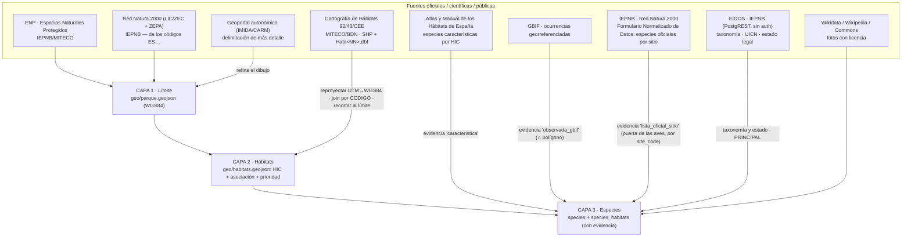

# El modelo: tres niveles de dato y tres capas

**Tres niveles.** Hacer cada espacio completo antes de pasar al siguiente dejaría el mapa de España
vacío durante años, así que se separan:

| Nivel | `status` | Contenido | Coste |
|---|---|---|---|
| **N1 · ficha base** | `basic` | Límite oficial, códigos Natura 2000, figura, superficie, municipios, `summary` | Lote automático: decenas de espacios por sesión |
| **N2 · completo** | `available` | Hábitats HIC recortados, catálogo de especies con evidencia, fotos, audioguías | Una sesión larga por espacio |
| **N3 · puntos de interés** | `available` | `pointsOfInterest`: qué ver dentro del parque y por qué, con fuente, coordenada y foto | Una sesión corta por espacio |

Todo espacio nace N1 y asciende cuando le toca. `planned` es un espacio anunciado sin carpeta de datos.

**N2 y N3 comparten `status`**: los POIs no dependen del tamaño ni del interés del espacio sino de si
alguien publicó la lista, así que avanzan a su ritmo y el nivel se registra en el ledger, no en el
código. El procedimiento y la cascada de fuentes están en `Docs/prompts/e-rollout-nacional.md` §4.

**Tres capas**, la misma arquitectura para cada espacio:

### El principio que lo gobierna todo

> **Ninguna base de datos oficial dice «la especie X vive en el polígono de hábitat Y».**
> Ese vínculo **siempre es derivado**. Lo sólido es construirlo cruzando dos señales y guardando **de
> dónde sale cada una**: por eso `species_habitats` tiene una columna `evidence`. Todo lo demás
> (límites, hábitats, taxonomía, estado de conservación) sí es dato oficial directo.

Corolario operativo, y la regla que manda sobre todas las demás:
**ante la duda, hueco documentado antes que dato inventado.**

### Lo que marca el usuario tiene dos vidas

Marcar una especie escribe en **dos** sitios, y no es una duplicación:

| Dónde | Para qué | Quién manda |
|---|---|---|
| `user_progress.payload` | Lo que la app pinta. Un JSON por (usuario, espacio), indexado por el `species_id` de ese espacio | El dispositivo: es lo que hace que el progreso funcione sin cobertura (local-first) |
| `user_occurrences` | La **capa científica**: una ocurrencia Darwin Core por cita, con identificador estable, hora con huso, incertidumbre de la coordenada, taxonomía con identificadores y estado de verificación | El servidor, que la deriva de la anterior |

La segunda existe porque la primera no se puede publicar: no se puede consultar, una especie solo
admite un avistamiento por espacio, y le faltan justo las piezas que hacen válida una cita. **La
capa científica se deriva de la de la app y nunca al revés**: borrar una fila de `user_occurrences` no
le quita nada al usuario. Cada ocurrencia cuelga además de la **visita verificada**
(`user_park_visits`) en la que se marcó, y de ahí hereda su trazabilidad de calidad.

El detalle completo —qué término sale de dónde, qué coordenadas se generalizan y por qué, y qué falta
para publicar en GBIF— está en [`Docs/DARWIN-CORE.md`](../DARWIN-CORE.md).

### Las especies son nacionales, no del parque

Una *Aquila fasciata* de Murcia y una de Cádiz son la misma ficha. El contenido de una ficha se parte
en dos y esa separación es la que hace que el catálogo escale:

- **Universal** — lo que la especie *es*: `commonName`, `kingdom`, `group`, `habitat`, `seasonality`,
  `rarityScore`, `description`, `tips`, `taxonomy`, `iucnGlobal`, `spainStatus`, `image`,
  `imageAttribution`. Vive en `Tools/catalogo-nacional/data/especies-universal.json`, **indexado por
  nombre científico**, y se sincroniza a todos los `park.json` con `npm run species:apply`.
- **Local** — dónde y cómo aparece *en este espacio*: `id`, `habitatIds`, `coordinates`, `featured`,
  `visible`, `source`, `reviewNote`, `zepaSiteCode`, `gbifOccurrences`, `gbifSpeciesKey`,
  `eidosTaxonId`, `murciaStatus`, `conservationStatus`, `audio`. Vive en cada `park.json`.

Si un texto universal nombra un parque concreto, es falso en cuanto la especie aparece en otro sitio.
`validate-park-data.js` lo trata como **error**, no como aviso: así acabaron 40 fichas de Sierra
Espuña hablando de una ZEPA de Cabo Cope.

### Los hábitats tampoco son del parque

El mismo corte, un nivel más arriba. Un **código HIC es el mismo tipo de hábitat en toda la
Directiva**: el 5330 de Almería y el de Tarragona son el mismo matorral termomediterráneo. Su
`description` describe esa vegetación, no el recinto que le tocó aquí.

- **Universal** — `description`, indexada por **código HIC** en
  `Tools/catalogo-nacional/data/contenido/habitats.json` y sincronizada a todos los `park.json` con
  `npm run habitats:apply`. (`name` y `type` también son universales, pero llegan por otra vía:
  `data/hic-nombres.json` → `adopt-habitats.js`.)
- **Local** — el polígono, la superficie, el centroide, el color, la foto, `speciesIds`,
  `reviewNote`, la audioguía y la `fitosociologia` que la cartografía asigna a *estos* recintos.

Las descripciones se escribieron mirando el espacio piloto y decían «terrestre del parque piloto» o
«marina de Cope» —falso en cuanto el código aparece en otro sitio, y aparece—; otras doce estaban
vacías. `validate-park-data.js` trata como **error** tanto el rastro local como que dos parques
tengan textos distintos para el mismo código.

**La asociación fitosociológica es dato oficial y no se toca**, pero por sí sola no le dice nada a
quien no es botánico. `Tools/catalogo-nacional/data/contenido/fitosociologia.json` le añade, sin
sustituirla, su lectura en llano («Coscojar con espino negro»), las plantas que le dan nombre y cómo
se leen la nomenclatura y la autoría; `habitats:apply` lo exporta a `Frontend/Data/fitosociologia.json`
y la ficha muestra las dos cosas: la explicación arriba y **la cita completa, con autores y año,
íntegra debajo**.

