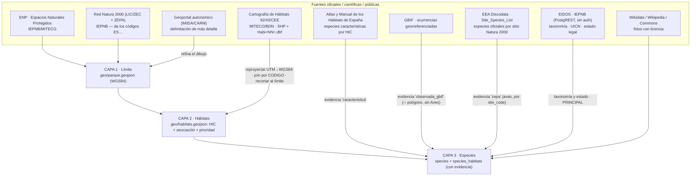

# NaturDex

Guía ambiental virtual de los espacios naturales protegidos de España. Una PWA orientada a móvil que
funciona sin cobertura: mapa con los límites oficiales, catálogo de hábitats y especies, fichas
divulgativas, y una mecánica tipo pokédex en la que descubrir una especie exige **estar allí** (la
posición se verifica contra el límite oficial del espacio).

> **Si retomas este proyecto en una sesión nueva, lee este documento entero antes de tocar nada.**
> Está escrito para que el proceso de dar de alta un espacio nuevo sea reproducible sin volver a
> descubrir de dónde sale cada dato. El histórico de decisiones —qué se hizo cada día y por qué— está
> en `Docs/rollout/ESTADO.md`; aquí solo está el **procedimiento vigente**.

## Estado (2026-08-04)

| | |
|---|---|
| Espacios dados de alta | **16** de los 21 de la Región de Murcia (4 descartados por reglas de producto, 1 retirado) |
| Con catálogo completo (**N2**) | 3 — Cabo Cope y Puntas de Calnegre (15 hábitats · 175 especies · 15 POIs), Sierra Espuña (13 · 190 · 0), Cuatro Calas (7 · 102 · 0) |
| Con ficha base (**N1**) | 13 — límite oficial y Red Natura 2000, sin catálogo |
| Catálogo universal de especies | **353** fichas distintas reutilizadas entre espacios |
| Invasoras · glosario · logros | 25 · 219 términos · 52 logros |
| Comunidades autónomas cubiertas | 1 de 17 |

El ledger espacio por espacio, con códigos ENP y huecos conocidos, está en `Docs/rollout/ESTADO.md`.

---

## 1. Arranque rápido

```bash
# Entorno completo (PHP + MySQL + Caddy)
cp .env.example .env       # las contraseñas son OBLIGATORIAS: sin ellas `up` falla a propósito
docker compose up -d       # la app queda en http://localhost:${WEB_PORT:-8080}
docker exec -i naturdex-db-1 sh -c 'MYSQL_PWD="$MYSQL_ROOT_PASSWORD" mysql' < Database/schema.sql
docker exec -i naturdex-db-1 sh -c 'MYSQL_PWD="$MYSQL_ROOT_PASSWORD" mysql naturadex' < Database/seed.sql

# Solo el frontend. Basta para casi todo el trabajo de datos: la app es offline-first y lee los
# park.json empaquetados; el backend es una mejora, no un requisito.
php -S localhost:8000 -t Frontend

npm install          # una sola dependencia: polygon-clipping
npm run validate     # red de seguridad de los datos empaquetados — TIENE que salir en verde
npm run hooks:install
```

Para actualizar una instalación antigua: `Database/migrations.sql` antes que nada (son `ALTER`
idempotentes). Despliegue: `DEPLOY.md`. Despliegue estático sin backend: `Docs/DESPLIEGUE_ESTATICO.md`.

---

## 2. Mapa del repositorio

```
Frontend/            PWA (sin framework, sin build). Módulos ES en Js/, datos empaquetados en Data/
  Data/parks-index.json          registro: comunidad → provincia → espacios, con su `status`
  Data/parks/<prov>/<slug>/      park.json + manifest.json + geo/*.geojson + tiles/base.pmtiles
  Js/api.js                      ÚNICO punto de contacto con Backend/Api (corte por tiempo, errores)
  Js/data.js                     carga de registro/manifiesto/datos/geo + progreso local-first
  sw.js                          Service Worker (network-first). Su lista SHELL_ASSETS hay que
                                 mantenerla al día: un módulo nuevo sin precachear rompe el offline
Backend/             API PHP + MySQL
  Api/*.php                      endpoints; todos arrancan con apiBoot() de Lib/api.php
  Lib/api.php                    prólogo común: cabeceras, CORS, preflight, sesión, respond()
  Lib/park_payload.php           forma canónica del JSON de un parque (API y exportador comparten)
  Lib/presence.php               verificación de presencia real (antitrampas). Ver Docs/
AdminPanel/          panel de administración (React+Vite) → se compila a Frontend/admin/
Database/            schema.sql (DDL) · seed.sql (datos) · migrations.sql (ALTER idempotentes)
                     *-universal.sql y *-imagenes.sql son GENERADOS: no se editan a mano
Tools/               tooling zero-dep (salvo polygon-clipping)
  lib/                           INFRAESTRUCTURA COMPARTIDA — empieza siempre por aquí
  catalogo-nacional/             el pipeline de datos por espacio
    data/descripciones-espacios.json   la descripción de cada espacio (texto redactado a mano)
    data/contenido/habitats.json       la descripción de cada hábitat, por código HIC (universal)
    data/contenido/fitosociologia.json la asociación fitosociológica en lenguaje llano
Docs/                documentación temática + rollout/ESTADO.md (el histórico)
```

### `Tools/lib/` — la infraestructura compartida

Antes de escribir una herramienta nueva, mira si lo que necesitas ya está aquí. Todo el tooling
depende de estos módulos, y cada uno existe porque su lógica estaba copiada y las copias divergieron.

| Módulo | Qué da | Por qué está aquí |
|---|---|---|
| `cli.js` | `arg` `num` `flag` `requireArgs` `die` `sleep` | Admite `--x v` y `--x=v`, y el nombre con o sin guiones. Había catorce copias con dos convenciones incompatibles |
| `http.js` | `getText` `getJson` `pool` | Acumula en Buffer (no parte caracteres multibyte), comprueba el `statusCode` y reintenta ante 429/5xx |
| `io.js` | `ROOT` `FRONTEND` `PARKS_DIR` `REGISTRY_FILE` `readJson` `writeJson` `parkFiles` `rel` | La raíz se resuelve una vez. `writeJson` usa el formato canónico (2 espacios + salto final): escribir de otra forma produce un diff completo aunque no cambie ningún dato |
| `eidos.js` | `resolveTaxon` `conservationByScope` `legalStatus` `commonName` | Cliente de EIDOS/IEPNB. `resolveTaxon` es **la clave maestra** del modelo (ver §4) |
| `gbif.js` | `matchName` `searchOccurrences` `esRangoEspecifico` | `matchName` devuelve el rango: una `usageKey` de género o familia no identifica ninguna especie |
| `registry.js` | `resolvePark` `readBoundaryPolygons` | Localiza los geo de un espacio. Acepta `available` **y** `basic` (un N1 ascendiendo a N2 es justo el caso de uso) |
| `geo.js` `shapefile.js` `dbf.js` | punto-en-polígono, áreas, parser `.shp` + reproyección UTM, lector dBASE | Sin dependencias |
| `wikimedia.js` | resolución de foto de un taxón contra Wikidata/Wikipedia/Commons | Lo delicado no es pedir la foto sino **descartar** la que no sirve (§6) |
| `db.js` | acceso al MySQL del contenedor por `docker exec` | La contraseña va por `MYSQL_PWD`, nunca en la línea de órdenes |
| `sql.js` | `sqlStr` `sqlStrOrNull` `sqlNum` `sqlJson` | Escapa la barra invertida, que MySQL trata como carácter de escape |

---

## 3. El modelo: tres niveles de dato y tres capas

**Tres niveles.** Hacer cada espacio completo antes de pasar al siguiente dejaría el mapa de España
vacío durante años, así que se separan:

| Nivel | `status` | Contenido | Coste |
|---|---|---|---|
| **N1 · ficha base** | `basic` | Límite oficial, códigos Natura 2000, figura, superficie, municipios, `summary` | Lote automático: decenas de espacios por sesión |
| **N2 · completo** | `available` | Hábitats HIC recortados, catálogo de especies con evidencia, fotos, audioguías | Una sesión larga por espacio |
| **N3 · puntos de interés** | `available` | `pointsOfInterest`: qué ver dentro del parque y por qué, con fuente, coordenada y foto | Una sesión corta por espacio |

Todo espacio nace N1 y asciende cuando le toca. `planned` es un espacio anunciado sin carpeta de datos.

**N2 y N3 comparten `status`**: los POIs no dependen del tamaño ni del interés del espacio sino de si
alguien publicó la lista, así que avanzan a su ritmo y el nivel se registra en el ledger, no en el
código. El procedimiento y la cascada de fuentes están en `Docs/prompts/e-rollout-nacional.md` §4.

**Tres capas**, la misma arquitectura para cada espacio:



### El principio que lo gobierna todo

> **Ninguna base de datos oficial dice «la especie X vive en el polígono de hábitat Y».**
> Ese vínculo **siempre es derivado**. Lo sólido es construirlo cruzando dos señales y guardando **de
> dónde sale cada una**: por eso `species_habitats` tiene una columna `evidence`. Todo lo demás
> (límites, hábitats, taxonomía, estado de conservación) sí es dato oficial directo.

Corolario operativo, y la regla que manda sobre todas las demás:
**ante la duda, hueco documentado antes que dato inventado.**

### Las especies son nacionales, no del parque

Una *Aquila fasciata* de Murcia y una de Cádiz son la misma ficha. El contenido de una ficha se parte
en dos y esa separación es la que hace que el catálogo escale:

- **Universal** — lo que la especie *es*: `commonName`, `kingdom`, `group`, `habitat`, `seasonality`,
  `rarityScore`, `description`, `tips`, `taxonomy`, `iucnGlobal`, `spainStatus`, `image`,
  `imageAttribution`. Vive en `Tools/catalogo-nacional/data/especies-universal.json`, **indexado por
  nombre científico**, y se sincroniza a todos los `park.json` con `npm run species:apply`.
- **Local** — dónde y cómo aparece *en este espacio*: `id`, `habitatIds`, `coordinates`, `featured`,
  `visible`, `source`, `reviewNote`, `zepaSiteCode`, `gbifOccurrences`, `gbifSpeciesKey`,
  `eidosTaxonId`, `murciaStatus`, `conservationStatus`, `audio`. Vive en cada `park.json`.

Si un texto universal nombra un parque concreto, es falso en cuanto la especie aparece en otro sitio.
`validate-park-data.js` lo trata como **error**, no como aviso: así acabaron 40 fichas de Sierra
Espuña hablando de una ZEPA de Cabo Cope.

### Los hábitats tampoco son del parque

El mismo corte, un nivel más arriba. Un **código HIC es el mismo tipo de hábitat en toda la
Directiva**: el 5330 de Almería y el de Tarragona son el mismo matorral termomediterráneo. Su
`description` describe esa vegetación, no el recinto que le tocó aquí.

- **Universal** — `description`, indexada por **código HIC** en
  `Tools/catalogo-nacional/data/contenido/habitats.json` y sincronizada a todos los `park.json` con
  `npm run habitats:apply`. (`name` y `type` también son universales, pero llegan por otra vía:
  `data/hic-nombres.json` → `adopt-habitats.js`.)
- **Local** — el polígono, la superficie, el centroide, el color, la foto, `speciesIds`,
  `reviewNote`, la audioguía y la `fitosociologia` que la cartografía asigna a *estos* recintos.

Las descripciones se escribieron mirando el espacio piloto y decían «terrestre del parque piloto» o
«marina de Cope» —falso en cuanto el código aparece en otro sitio, y aparece—; otras doce estaban
vacías. `validate-park-data.js` trata como **error** tanto el rastro local como que dos parques
tengan textos distintos para el mismo código.

**La asociación fitosociológica es dato oficial y no se toca**, pero por sí sola no le dice nada a
quien no es botánico. `Tools/catalogo-nacional/data/contenido/fitosociologia.json` le añade, sin
sustituirla, su lectura en llano («Coscojar con espino negro»), las plantas que le dan nombre y cómo
se leen la nomenclatura y la autoría; `habitats:apply` lo exporta a `Frontend/Data/fitosociologia.json`
y la ficha muestra las dos cosas: la explicación arriba y **la cita completa, con autores y año,
íntegra debajo**.

---

## 4. Procedencia de cada campo

Esta es la tabla que hay que consultar antes de rellenar nada. **Columna «Fuente» = de dónde sale el
dato; «Cómo» = la herramienta o el criterio; «Verifica» = quién lo comprueba.**

### `parks` — el espacio protegido

| Campo | Fuente | Cómo | Verifica |
|---|---|---|---|
| `slug` | decisión propia | Sin tildes, minúsculas, guiones. **Es una clave: estable para siempre** | `validate` (coincide con el registro) |
| `name`, `category` | ENP (IEPNB/MITECO) | Figura oficial **literal** («Parque Regional», «Paisaje Protegido») | `validate` (avisa si difiere del registro) |
| `region`, `province`, `municipality` | ENP + límites municipales del CNIG | El municipio NO está en la capa ENP: sale de cruzar el centroide contra el CNIG | manual |
| `area_hectares` | ENP | La superficie **oficial la manda el MITECO** aunque el dibujo venga del geoportal autonómico | manual |
| `latitude`/`longitude` (`center`) | calculado | Centroide del límite | `validate` (dentro de la caja de España) |
| `description` (`summary`) | redacción propia — `data/descripciones-espacios.json` | **El único texto del pipeline que no sale de una fuente oficial.** 130–150 caracteres: es lo que se lee entero en el hueco de la cabecera. Qué paisaje es y qué se ve allí; cero adjetivos de folleto. Vive en ese fichero y no en el `park.json` para que **una regeneración con `n1:build` no pueda pisarlo** | revisión humana |
| `status` | proceso | `basic` → `available` al cerrar la Capa 3 | `validate` (rechaza valores desconocidos) |
| `boundaryNote` | proceso | **Obligatorio**: de qué servicio salió el límite y su código ENP | `validate` (campo exigido en N1) |

### `habitats` — Capa 2

| Campo | Fuente | Cómo | Verifica |
|---|---|---|---|
| `code` (HIC) | MITECO/BDN `Habi<NN>.dbf`, columna `CODIGO_UE` | Join `shapefile.CODIGO ↔ Habi<NN>.CODIGO` | `validate` (unicidad por parque) |
| `geometry` | MITECO/BDN, shapefile de recintos | `build-habitats.js`: reproyecta UTM→WGS84 y **recorta al límite** | `validate` (0 vértices fuera de España); el propio script informa de vértices fuera del límite, que debe ser **0** |
| `name`, `habitat_type` | `data/hic-nombres.json` | ⚠️ Un código **ausente de este fichero** no se queda solo sin nombre: **se salta el filtro marino** y entra un hábitat que no debería. Ver §6 | `adopt-habitats.js` avisa de los códigos sin ficha |
| `is_priority` | `data/hic-prioritarios.json` (Anexo I de la Directiva) | **NUNCA del flag `PRIORITARI`** del dato de 1997, que es poco fiable (marca 8210 como prioritario) | revisión contra el Anexo I |
| `fitosociologia` | `Habi<NN>.dbf`, columna `CONCEPTO` | Asociaciones oficiales, **literales**. Es lo que justifica reconciliar un código antiguo. Su lectura en llano vive aparte, en `data/contenido/fitosociologia.json`, y **no la modifica** | manual |
| `hic_subtipos` | `Habi<NN>.dbf` | Subtipos concretos presentes (5330 → `["5334"]`) | — |
| `description` | universal — `data/contenido/habitats.json` | Redacción propia sobre el Atlas de Hábitats y el Anexo I, **indexada por código HIC** y por tanto válida en cualquier parque de España. Se sincroniza con `npm run habitats:apply`. **Nunca puede nombrar un espacio concreto** | `validate` (**error** si nombra un parque o si dos parques discrepan) |
| `latitude`/`longitude` | calculado | Centroide. Solo para el círculo aproximado cuando no hay polígono | `validate` |
| `color` | decisión propia | Paleta del catálogo. La **trama** la pone el grupo (§8) | — |
| `image`, `image_attribution`, `image_note` | Wikimedia Commons | `habitat-images.js`: un hábitat no es un taxón, así que se ilustra con su **especie diagnóstica** —la que el propio hábitat nombra— y se explica en `image_note` | `validate` (foto sin atribución = aviso) |
| `speciesIds` | derivado | Inverso de `species.habitatIds` | `validate` (simetría e integridad referencial) |
| `audio_url`, `audio_transcript` | producción propia | La transcripción es **obligatoria** (WCAG 1.2.1) | `validate` (**error** si falta) |

### `species` — Capa 3

| Campo | Ámbito | Fuente | Cómo |
|---|---|---|---|
| `scientific_name` | universal | **EIDOS** `v_taxonomia` | El **nombre aceptado**, no el sinónimo. `eidos.resolveTaxon()` lo resuelve |
| `eidos_taxonid` | local | EIDOS | **La clave maestra.** Es lo que permite reutilizar una ficha entre espacios sin duplicarla |
| `gbif_species_key` | local | GBIF `species/match` | ⚠️ Comprobar el **rango**: si no es SPECIES/SUBSPECIES, la clave es de género o familia y no identifica nada (el catálogo llegó a tener 3073 = Poaceae como «clave del esparto») |
| `common_name` | universal | EIDOS `v_nombrescomunes` (preferente en castellano) → Wikipedia | — |
| `kingdom`, `taxon_*` | universal | EIDOS `v_taxonomia` | `flora`/`fauna`/`fungi`/`other` + los seis rangos |
| `group` | universal | vocabulario **cerrado** | Había 79 valores distintos en un parque. `sync-species-catalog.js` traduce con `GRUPO_NORMALIZADO`. `group` dice solo *qué clase de ser vivo es*; la familia va en `taxonomy` y el ambiente en `habitat` |
| `iucn_global` | universal | EIDOS `v_estadoconservacion` (`aplicaa` = Mundial) → UICN Red List | Solo la fila **vigente más reciente** de cada ámbito |
| `spain_status` | universal | EIDOS `v_estadolegal` ámbito Nacional (CEEA/LESRPE) + Lista Roja de la Flora Vascular 2008 | La Lista Roja es evaluación científica, **no norma jurídica**: por eso muchas plantas no salen en `v_estadolegal` y eso no es un error |
| `murcia_status` | local | EIDOS `v_estadolegal` ámbito CCAA | ⚠️ **Nombre atado a Murcia. Es la deuda nº 1 del rollout: ver §9** |
| `conservation_status` | local | derivado | Etiqueta corta para la tarjeta. En flora refleja el estado **legal**, no la evaluación UICN: son dos ejes distintos y mezclarlos ya causó un problema |
| `description`, `tips`, `habitat`, `seasonality` | universal | redacción propia sobre fuentes | Prosa divulgativa. `tips` = tres rasgos que se ven en campo. **Nunca puede nombrar un espacio concreto** |
| `image`, `image_attribution` | universal | Wikimedia (`wikimedia-images.js`) → GBIF (`enrich-images.js`) | URL canónica `Special:FilePath`, nunca un `/thumb/` (`validate` lo trata como **error**). Autor + licencia obligatorios |
| `rarity_score` | universal | criterio propio 1–5 | Ordena el catálogo y elige la especie diagnóstica de un hábitat |
| `source` | local | proceso | La referencia concreta que respalda **la cita en este espacio** |
| `review_note` | local | proceso | La duda, escrita y visible en la app («a revisar»). Es el mecanismo de «hueco documentado» |
| `habitatIds` | local | derivado | Ver `species_habitats` abajo |
| `zepa_site_code` | local | Discodata BISE | Las aves **no se cuelgan de hábitats**: vuelan. Van a su apartado de espacio |
| `is_visible` | local | criterio | `false` oculta del catálogo público sin borrar (pocas ocurrencias GBIF **y** sin figura oficial) |
| `coordinates` | local | representativa | La ubicación real la aporta el GPS al marcar la especie como vista |

### `species_habitats.evidence` — el vínculo derivado

| Valor | Fuente | Criterio |
|---|---|---|
| `caracteristica` | Atlas de Hábitats | La especie figura como característica de ese HIC **y** está en el catálogo del espacio. Backbone determinista y filtro de cordura del resto |
| `observada_gbif` | GBIF | Ocurrencia **dentro del polígono** (punto-en-polígono local, no bbox). `gbif_occurrences` guarda cuántas |
| `zepa` | EEA Discodata BISE | Lista oficial de especies del sitio Natura 2000 (`site_code`) |

### Otras tablas

| Tabla | Fuente | Herramienta |
|---|---|---|
| `especies_invasoras` | Catálogo Español de EEI (RD 630/2013) vía EIDOS ∩ presencia GBIF por CCAA | `invasoras-eei.js`, `invasoras-contenido.js`, `invasoras-images.js` |
| `glosario` | redacción propia sobre glosarios oficiales y el Atlas | `glossary-coverage.js` **detecta** el vocabulario sin definir; la definición la escribe una persona |
| `user_*` | el propio usuario | Progreso, visitas verificadas, logros. Ver `Docs/PROGRESO-CUENTA-LOGROS.md` y `Docs/VERIFICACION-Y-ANTITRAMPAS.md` |

### Fuentes: URLs y claves

| Fuente | Acceso | Claves y notas |
|---|---|---|
| **ENP** | IEPNB catálogo `408ec0c0-7823-5c91-9f72-8c06e3df8b9e` · WMS `wms.mapama.gob.es/sig/Biodiversidad/ENP/wms.aspx` | EPSG:4326. Capa nacional de referencia |
| **Red Natura 2000** | IEPNB catálogo `dc7a3014-cd9a-51b8-ad62-7aab55afecdd` | Da los códigos `ES…`, llave de la lista oficial de especies. Publicada a 31/12/N, su contenido es lo remitido a la Comisión hasta diciembre de N−1 |
| **Cartografía de Hábitats 92/43/CEE** | `miteco.gob.es/…/habitat_descargas_2.html` | Dos ficheros por provincia `NN`: `DirectivaHabitat<NN>_1997_*.zip` (polígonos) y `directivadatos_<NN>_*.zip` → `Habi<NN>.dbf` (atributos). Las URL llevan sufijos `_tcm30-NNNNNN` **no derivables**: están copiadas en `Tools/catalogo-nacional/fuentes/habitat-provincias.json` (las 50 provincias) |
| **Atlas y Manual de los Hábitats de España** | PDF en `Docs/` | Extraer con `pdftotext -layout` |
| **EIDOS** | `https://iepnb.gob.es/api/especie/` (PostgREST, **sin autenticación**) | `v_taxonomia` (`taxonid`), `v_estadoconservacion`, `v_estadolegal`, `v_nombrescomunes`, `v_atributos_pliniancore`. Lista Patrón en `/api/catalogo/` |
| **GBIF** | `https://api.gbif.org/v1/` | `occurrence/search` (paginar a 300), `species/match` |
| **EEA Discodata (BISE)** | `https://discodata.eea.europa.eu/sql?query=…` | Tabla `[BISE].[latest].[Site_Species_List]`. URL-encode; bloquea tablas de sistema |
| **Geoportal IMIDA/CARM** | `geoportal.imida.es/…/PROYECTOS/OISMA/MapServer` | Delimitación con 2–15× más vértices que la capa nacional |

---

## 5. Runbook: dar de alta un espacio

### Fase 1 — N1, una comunidad entera de golpe

```bash
node Tools/catalogo-nacional/build-n1-espacios.js --nuts2 <CODIGO> [--dry] [--solo <ES…>]
node Tools/catalogo-nacional/refina-limites-imida.js [--dry]      # si hay geoportal autonómico
npm run tiles:build <slug>                                        # mapa base offline por espacio
npm run validate
```

`build-n1-espacios.js` es **idempotente** y genera, por espacio: `geo/parque.geojson`,
`geo/lic.geojson`, `geo/zepa.geojson`, `park.json` (solo el bloque `park`), `manifest.json` con
contadores a cero, y la entrada en `parks-index.json` con `status: "basic"`.

Antes de escribir nada, **presenta el inventario y espera el visto bueno**: nombre oficial, figura,
provincia, municipios, superficie, código ENP y códigos Natura 2000. Puede haber espacios que excluir.

### Fase 2 — N2, un espacio por sesión

**Paso 0 · confirmar parámetros y parar si alguno no cuadra**

- `REGION_NN` (código INE de provincia, para los ficheros del MITECO).
- **Huso UTM: NO lo asumas.** Léelo del `.prj` del shapefile descargado y dilo en voz alta.
- `SITE_CODES` (los `ES…` de LIC/ZEC y ZEPA), leídos de los geojson que ya existen del N1.
- Ruta del límite en WGS84.

**Capa 2 · hábitats**

```bash
node Tools/catalogo-nacional/build-habitats.js --park <SLUG> \
     --shp <ruta>.shp --datos Habi<NN>.dbf --zone <HUSO>
# Revisar ANTES de fusionar: recintos recortados, vértices fuera del límite (debe ser 0),
# recintos sin HIC descartados, códigos antiguos a reconciliar.

node Tools/catalogo-nacional/merge-habitats.js --park <SLUG> \
     --official Tools/catalogo-nacional/out/<SLUG>-oficial.geojson [--reconcile 8230:8210]

node Tools/catalogo-nacional/adopt-habitats.js --park <SLUG> --dry   # revisar
node Tools/catalogo-nacional/adopt-habitats.js --park <SLUG>         # escribir
```

`merge-habitats` conserva lo curado a mano y actualiza desde la fuente lo que es dato. `adopt-habitats`
lo lleva a `Frontend/`, sincroniza `park.json` y recalcula los contadores del manifiesto. Si aparecen
códigos HIC nuevos, **amplía `data/hic-nombres.json` y `data/hic-prioritarios.json` antes** (§6).

**Capa 3 · especies — el orden importa, de más sólido a más ruidoso**

1. **Reutilización primero.** Cruza contra `especies-universal.json` por `eidosTaxonId`. Lo que ya
   existe se **enlaza**, no se reescribe. Di cuántas reutilizas y cuántas son nuevas.
2. **Atlas de Hábitats** → `atlas-hic-especies.js` → evidencia `caracteristica`. Backbone determinista.
3. **EIDOS** para toda especie nueva: taxonomía, UICN por ámbito, estado legal, nombre común.
4. **GBIF ∩ polígonos, sin Aves** → `gbif-habitats.js` → evidencia `observada_gbif`.
5. **Aves** → Discodata BISE por `site_code` → evidencia `zepa`, apartado propio del espacio.
6. **Reconciliación taxonómica** → `reconcile-taxa.js`.

**Regla de selección** (ajústala al tamaño del espacio y **dilo**). La usada en Cuatro Calas:

> Se excluyen las no nativas (van a Invasoras, que es regional). Se mantiene una especie si **(a)**
> tiene figura legal vigente en EIDOS, **(b)** el Atlas la da como característica de alguno de los HIC
> cartografiados aquí, o **(c)** tiene **≥ N ocurrencias** de GBIF dentro de un mismo hábitat.

En Sierra Espuña (80× más grande) el umbral fue 15 y luego 50; en Cuatro Calas, 3. El umbral no es
una constante universal: es una decisión por espacio que hay que dejar escrita en el informe de cierre.

**POIs, fotos y cierre**

```bash
npm run species:extract      # vuelca a especies-universal.json lo nuevo de los park.json
npm run images:species       # fotos de Wikimedia con atribución
npm run images:habitats      # portadas de hábitat
npm run images:pois          # fotos de POIs desde la categoría de Commons del espacio
npm run species:apply        # sincroniza los campos universales a TODOS los park.json + SQL
npm run habitats:check       # hábitats sin descripción universal, textos con rastro de un parque
npm run habitats:apply       # descripción por código HIC a TODOS los park.json + Data/fitosociologia.json + SQL
node Tools/build-park-trails.js <slug>
npm run pois:build <slug>    # candidatos a POI recortados al polígono (NO escribe park.json)
npm run tiles:build <slug>
npm run validate             # hasta verde
npm run glossary:check       # vocabulario nuevo sin definición
npm run taxones:duplicados   # el mismo taxón con dos nombres
```

POIs **solo desde fuente documental** (PORN/PRUG, red de senderos oficial, cartografía del organismo
gestor). Un POI sin fuente no entra. `pois:build` **no** salta esa regla: barre OpenStreetMap dentro
del límite —vía Overpass, o vía el `base.pmtiles` del propio parque cuando no hay red— y deja los
candidatos con su coordenada en `Tools/catalogo-nacional/out/<slug>-poi-candidatos.md`. El hecho, la
fuente, la foto y la descripción se ponen a mano; la herramienta solo dice dónde mirar.
Después: `status` a `available` en `parks-index.json`, cargar la
BD, y actualizar `Docs/rollout/ESTADO.md` con el informe de cierre (contadores, cobertura de fotos,
especies sin hábitat, huecos conocidos y qué contrastar en campo).

### Definición de «terminado»

**N1**: está en `parks-index.json` como `basic`, su límite oficial se dibuja, `npm run validate` pasa
y la ficha declara su fuente en `boundaryNote`.

**N2**: además, sus hábitats vienen del MITECO recortados a su límite (**0 vértices fuera**), toda
especie tiene `source` + `evidence` + estado en las tres escalas, las aves están en su apartado ZEPA y
no colgadas de hábitats, ninguna foto es de licencia dudosa, los contadores del manifiesto cuadran y
el informe de cierre lista los huecos conocidos.

### Checklist de cierre

```
[ ] npm run validate                    en verde (los avisos preexistentes, contados y explicados)
[ ] npm run taxones:duplicados          código 0, o los pendientes justificados
[ ] npm run glossary:check              vocabulario nuevo redactado o anotado
[ ] npm run species:extract             SEGUNDO pase → 0 cambios (idempotencia)
[ ] npm run species:apply               SEGUNDO pase → 0 fichas actualizadas
[ ] npm run habitats:check              0 hábitats sin descripción y 0 asociaciones sin lectura llana
[ ] npm run habitats:apply              SEGUNDO pase → 0 hábitats actualizados
[ ] adopt-habitats.js --dry             converge: «=» en los tres ficheros
[ ] status → "available" en parks-index.json
[ ] manifest.version subido y updatedAt al día (si no, el offline no revalida)
[ ] SQL generado Y aplicado (la API tiene prioridad sobre el park.json — §7.3)
[ ] Docs/rollout/ESTADO.md con el informe de cierre y los huecos
```

### Prompt para retomar en una sesión nueva

> Retomo el rollout de NaturDex. Contexto: el README raíz — modelo de dos niveles (N1/N2) y tres capas
> (§3), procedencia de cada campo (§4), runbook (§5), trampas (§6) y orden de operaciones (§7). El
> estado por espacio está en `Docs/rollout/ESTADO.md`.
>
> Empieza preguntándome **qué espacio** procesamos y confírmame antes de descargar nada: su
> `REGION_NN`, el **huso UTM leído del `.prj`** (no lo asumas) y sus códigos Natura 2000. Si alguno no
> cuadra, para y dímelo.

---

## 6. Trampas conocidas

Cada una costó una sesión de depuración. Léelas antes de repetirlas.

**Geometría y cartografía**

- **Hay que reproyectar.** Pese a que GeoJSON exige WGS84, el MITECO publica en UTM y lo declara en el
  miembro `crs`. Sin reproyectar, el parque se dibuja en mitad del Atlántico. El validador tiene una
  comprobación específica para cazarlo (vértices fuera de la caja de España).
- **El huso depende de la región**: 28N Canarias, 29N, 30N, 31N. Léelo del `.prj`, no lo supongas.
- **Se generaliza en UTM, no en grados.** Un grado de longitud mide ~88 km aquí y uno de latitud ~111:
  la misma tolerancia deforma más en un eje que en otro.
- **Lectura por streaming.** `Enp2025_p.json` pesa 190 MB y el de Red Natura 620 MB, ambos en **una
  sola línea**: un `JSON.parse` revienta el heap de Node.
- **El solape con Red Natura se mide, no se supone.** El bbox da falsos positivos (una ZEPA marina
  grande envuelve un monumento de interior sin tocarlo). Se usa solo como prefiltro barato.
- **Un espacio protegido suele ser multiparte y con enclaves excluidos.** Recortar contra el primer
  anillo dio un límite 446 ha mayor que el real en Sierra Espuña.
- **`COBERTURA` viene vacía** en el dato de 1997 y el flag `PRIORITARI` es poco fiable.
- **Códigos HIC antiguos**: `8230` + asociación `Hypericion ericoidis` es roquedo casmofítico
  calcícola → hoy **8210**. Reconciliar **solo si la asociación lo justifica**.
- **El dato oficial es un MOSAICO**: un recinto lleva varios HIC sobre el MISMO polígono (el mayor de
  Cuatro Calas cataloga nueve), así que una ocurrencia cae en todos a la vez y la geometría no permite
  discriminar. Criterio: si el Atlas respalda la especie para alguno de los HIC del recinto, se enlaza
  **solo a ésos**; si no, a todos.
- **Un código ausente de `hic-nombres.json` se salta el filtro marino.** Sin ficha, el pipeline le pone
  nombre `HIC <código>` y tipo `Hábitat`, que no es un tipo excluido — y así entró un hábitat marino de
  0 ha llamado literalmente «HIC 1110». Para códigos que la cartografía recorta dentro del espacio pero
  que su formulario normalizado **no declara**, está `data/hic-excluidos.json`.

**Taxonomía**

- **Las tres fuentes reclasifican y usan nomenclaturas distintas** (Larus→Ichthyaetus, Salvia
  rosmarinus→Rosmarinus, Accipiter→Astur, Stipa→Macrochloa). Sin `eidos_taxonid` como clave maestra, al
  décimo parque hay diez fichas del mismo águila con textos divergentes.
- **El punto ciego de identificar por nombre**: si el mismo taxón se da de alta con el basónimo en un
  espacio y con el nombre aceptado en otro, para el validador son dos especies y no hay nada que
  comparar. Pasó con el esparto. `npm run taxones:duplicados` agrupa por identificador externo, que es
  lo único que lo delata, y **sale con código 1 mientras queden**.
- **No trunques el nombre a dos palabras** para emparejar: rompe las subespecies. Se empareja por
  prefijo terminado en espacio (`eidos.nameMatches`).
- **El cruce con el Atlas hay que hacerlo con los DOS nombres** (el de GBIF y el aceptado por EIDOS).
  Con solo el de GBIF, *Periploca laevigata* no casaba con la *P. angustifolia* del Atlas y la especie
  diagnóstica del 5220 se quedaba sin enlace — y el hábitat, sin portada.
- **La misma columna se llama distinto según la vista de EIDOS**: `taxonid` en `v_taxonomia`,
  `idtaxon` en las de detalle, `id_taxon` en `v_imagenes`. Filtrar por la equivocada **no da error
  HTTP**: PostgREST devuelve 200 con un objeto de error, el `for...of` revienta y el informe sale con
  «0 rellenadas / 0 sin foto», como si no hubiera nada que hacer. `eidos.rows()` normaliza a array.

**Fotos y licencias**

- **Ordenar solo por licencia elige pliegos de herbario.** Los herbarios digitalizan en CC0/CC-BY y
  iNaturalist publica en CC-BY-NC, así que un pliego prensado **siempre** ganaba a la foto de campo. El
  orden correcto es *foto de campo antes que pliego* → licencia → país.
- **`/by\b/` no detecta CC BY.** La licencia de naturgucker es literalmente «*Copyright by the
  creator…*» y así acabó una foto con derechos reservados en una ficha. El patrón va anclado (`cc by`,
  `/licenses/by`) y con lista de exclusión (`copyright by`, `all rights reserved`, `©`).
- **`by-nc-nd` no es `by-nc`**: la atribución tiene que decir la licencia real, cláusula *sin obra
  derivada* incluida.
- **Nunca enlaces un `/thumb/` de Wikimedia**: es un derivado cacheado y devuelve 400 en cuanto no está
  generado. Usa `Special:FilePath`. El validador lo trata como **error**.
- **El `_` de los nombres de Commons es carácter de palabra**, así que `\bplate\b` no casa con
  `…(Plate_16)…` y se colaron láminas del XIX.
- **`redirects=1` puede llevarte a otro reino**: de la gramínea *Sphenopus divaricatus* al artículo del
  género *Sphenopus*, que es **un zoantario**. Hay que rechazar el archivo que nombra el mismo género
  con otro epíteto.
- **Revisa mirando la imagen**, no solo su licencia: es la única forma de cazar lo que ningún filtro caza.

**GBIF**

- **Filtra Aves**: son el 88 % de las ocurrencias y casi todo ruido espacial (vuelan).
- **El filtro por incertidumbre de coordenada no sirve**: solo el 14 % la declara.
- **`usageKey` no siempre es de rango específico** (ver §4).
- **Punto-en-polígono local**, no consulta espacial: evita el límite de complejidad y de longitud de URL.

---

## 7. Orden de operaciones

Hay dependencias entre herramientas que no son evidentes y que, al saltárselas, deshacen trabajo en
silencio. **Ninguna de estas tres se detecta con un error: todas fallan en verde.**

1. **`image`/`imageAttribution` son campos UNIVERSALES.** Si escribes una foto en el `park.json` (con
   `enrich-images.js --write-park`) y después lanzas `species:apply` sin haber hecho antes
   `species:extract`, el catálogo universal **pisa la foto recién puesta** y vuelve a null. Lo robusto
   es escribir la foto en `especies-universal.json` y luego `--apply`.
2. **`data/contenido/*.json` manda sobre todo lo demás.** Es lo correcto (es texto escrito para ser
   universal), pero significa que una entrada obsoleta ahí revierte cualquier corrección en cada
   `--extract`. Ya pasó: una entrada fijaba la foto de *Anabasis hispanica* a un pliego borrado del
   disco, y cada extracción reponía la ruta muerta. Hoy `sync-species-catalog.js` **ignora y avisa** de
   las fotos locales inexistentes, pero la regla sigue en pie: al corregir un campo universal, mira si
   `contenido/` lo está fijando.
3. **La API tiene prioridad sobre el `park.json` empaquetado** (`Frontend/Js/data.js`). Con backend
   desplegado, tocar solo los ficheros del frontend no cambia lo que ve el usuario: hay que generar y
   aplicar también el SQL. Y al revés — `adopt-habitats.js` escribe en `Frontend/` y **no pasa por la
   BD**: mientras el pipeline de hábitats siga así, un export desde la API borraría sus cambios.

**Idempotencia.** `build-n1-espacios`, `merge-habitats`, `adopt-habitats`,
`fix-estado-conservacion-iepnb` y `sync-species-catalog` son idempotentes: reejecutarlos con la misma
entrada no cambia ni un byte. Es la comprobación más barata de que algo se ha hecho bien —
**si un segundo pase produce un diff, hay un problema**.

**Regenerar el `park.json` desde la BD** (tras editar en el panel de administración):
`npm run export:park -- <slug>`. Sube `manifest.version` para que el offline revalide.

---

## 8. La aplicación

Todo lo que sigue son decisiones de producto ya tomadas y en producción; el detalle está en `Docs/`.

**Flujo**: portada → login → mapa de España (selector agrupado por comunidad y provincia, con «ir al
parque más cercano») → espacio. Lo pesado del espacio se carga **solo al elegirlo**.

**La cabecera del espacio** responde a lo primero que se pregunta quien acaba de entrar —*qué es este
sitio*— con tres piezas: (1) **figura y superficie oficial** («Parque Regional · 2666 ha»), tomadas de
las propiedades del propio `geo/parque.geojson`, la misma geometría que se dibuja, así que la tienen
los dieciséis espacios sin un campo más que mantener; (2) **la descripción** del paisaje (§4); y (3)
**los tres recuentos de lo que se colecciona**: hábitats, especies y POIs. La tercera casilla eran los
kilómetros de costa, un dato que ni se colecciona ni existe en un espacio de interior (salía «—» en
trece de dieciséis). Un espacio sin puntos cargados muestra «—», no un cero: el dato está pendiente,
no vacío.

**Hábitats por grupos** (`Js/habitat-groups.js`). Un espacio trae entre 11 y 21 hábitats, y con una
lista plana no hay forma de gestionar el solapamiento en el mapa desde un móvil en el campo. Se
reparten en **siete grupos** ordenados del mar hacia dentro (costa y dunas, saladares, ríos y riberas,
matorrales, pastizales, roquedos, bosques). El criterio es el **código HIC**, que ya agrupa por grandes
tipos. Cada grupo tiene su trama y su tinta, **las mismas en los tres sitios** donde aparece: el mapa
(la trama dice el grupo, el borde toma el color propio del hábitat), la leyenda y el catálogo. Los
bosques de galería (91B0–92D0) van con el agua, no con los bosques: es el río lo que los explica.

**Navegación de «un paso atrás»** (`Js/nav.js`). Siendo una app de una sola página, todo lo que se abría
era una única entrada de historial, así que el botón «atrás» del móvil sacaba de la web entera con el
trabajo a medias. Regla única: **todo lo que se abre es un nivel apilado y «atrás» cierra el de arriba**,
venga del sistema, de Escape o de un botón. El historial se pone al día **al final del turno**, en una
microtarea: `history.go()` es asíncrono, y un manejador que cerraba un nivel y abría otros dos disparaba
un retroceso que llegaba *después* y deshacía justo lo que el usuario acababa de abrir.

**Las etiquetas del mapa son fichas, no globos.** El `autoPan` de Leaflet solo garantiza que el globo
entre en el *contenedor*, que en móvil está tapado arriba y abajo; y «tocar fuera» casi nunca era mapa
vacío sino otro polígono, que abría *su* globo. Ahora todo abre en el mismo sitio donde se leen las
fichas, con un solo modo de cerrarse. Todo encuadre pasa por `chromeInset()` en `map.js`.

**Sin conexión**, en tres capas (`Js/offline.js` + `sw.js`): (1) caché automática en `localStorage` de
todo JSON descargado — visitar un espacio online **una vez** deja sus datos y sus mapas vectoriales
disponibles; (2) botón «Guardar sin conexión», que baja además las imágenes y el paquete de teselas;
(3) Service Worker con el armazón, **network-first** para que la app nunca se quede atascada en una
versión antigua. El progreso es **local-first** con cola de pendientes idempotente.

**Mapa base offline**: `npm run tiles:build <slug>` recorta el basemap de Protomaps al **límite oficial**
(no al bbox: en un espacio costero medio bbox es mar). ~1 MB por espacio. No se empaqueta desde
tile.openstreetmap.org porque su política de teselas prohíbe expresamente el prefetch y el uso offline;
el basemap de Protomaps es una *Produced Work* de OSM bajo ODbL, redistribuible **exigiendo atribución**,
que viaja en el propio manifiesto para poder pintarla sin red. Presupuesto por espacio: **25 MB**
(mapa + fotos + audio), comprobado por el validador.

**Presencia verificada.** Descubrir una especie exige estar allí: cada posición se valida contra el
límite oficial y la visita solo se marca `verified` con presencia sostenida. No se guarda la traza del
paseo, solo el agregado. Ver `Docs/VERIFICACION-Y-ANTITRAMPAS.md`.

---

## 9. Deuda técnica, por orden de rentabilidad

Cada una se paga mejor ahora que en el espacio número treinta.

1. **`murcia_status` está atado a Murcia.** Es el bloqueo real del rollout nacional a nivel de campo:
   cada comunidad tiene su propio catálogo de especies amenazadas. Hay que renombrarlo a algo como
   `regional_status` + `regional_norma`, y tocar exactamente: `Database/schema.sql` y una migración,
   `Backend/Lib/park_payload.php:129`, `Backend/Api/admin.php` (3 sentencias),
   `Frontend/Js/render.js:423` (que además tiene la etiqueta «Región de Murcia» escrita a mano),
   `Tools/sync-species-catalog.js` (lista `LOCALES`) y `Tools/catalogo-nacional/fix-estado-conservacion-iepnb.js`.
   Hace falta además una tabla **comunidad → norma** para que el campo no sea texto libre distinto en
   cada espacio. `Tools/eidos-diff.js` ya acepta `--ccaa`.
2. **El pipeline de hábitats no escribe en la BD.** `adopt-habitats.js` toca `Frontend/` y nada más, así
   que un export desde la API borraría sus cambios sin avisar. Mientras siga así, cualquier cambio suyo
   es provisional (§7.3).
3. **Claves externas incoherentes** — lo que reporta hoy `npm run taxones:duplicados` (sale con
   código 1 mientras queden):
   - **1 taxón duplicado**: la `gbifSpeciesKey` **3064** está puesta en dos especies distintas de
     Cabo Cope (*Salsola vermiculata* y *Arthrocnemum macrostachyum*) porque **3064 es Amaranthaceae,
     la FAMILIA**. Una clave de familia no identifica nada: cualquier consulta de ocurrencias con ella
     devuelve la familia entera. Mismo caso en *Stipa capensis* (3073 = Poaceae) y *Sedum sediforme*
     (2406 = Crassulaceae). **Estos tres son arreglo mecánico**: basta volver a resolverlos con
     `gbif.matchName()`, que ahora devuelve el rango y permite rechazar lo que no sea específico.
   - **9 identificadores incoherentes** entre espacios: `eidosTaxonId` distinto en `Sedum sediforme`
     y `Olea europaea var. sylvestris`, y `gbifSpeciesKey` distinta en siete casos donde un espacio
     usa la clave del sinónimo y otro la del nombre aceptado. **Estos NO son mecánicos**: exigen
     decidir si el catálogo sigue el nombre aceptado de EIDOS a rajatabla y, en varios, si la cita del
     espacio se refiere de verdad al taxón que GBIF considera aceptado.
   - `eidosTaxonId` duplicados: **0**. El esparto era el único de su clase.
4. **Tabla de reconciliación taxonómica nacional.** Existe la del piloto
   (`out/cabo-cope-puntas-calnegre-reconciliacion.json`, 124 especies); falta acumular todos los
   espacios sin duplicar por `eidos_taxonid`.
5. **Completar `hic-nombres.json` y `hic-prioritarios.json`** al entrar en cada provincia nueva. No es
   opcional: un código sin ficha se salta el filtro marino (§6).
6. **Fotos de florasilvestre.es pendientes de licencia** en Cabo Cope: 13 fichas usadas en el contexto
   de este prototipo educativo. Antes de cualquier uso público hay que confirmar el permiso o
   sustituirlas por equivalentes de licencia libre.
7. **Cero POIs en Sierra Espuña y Cuatro Calas.** No hay fuente con coordenadas descargables; el PRUG en
   PDF sigue siendo la vía pendiente. Los senderos sí están resueltos (`build-park-trails.js`), pero son
   trazas, no puntos.
8. **Duplicación consciente**: `AdminPanel/src/api.ts` y el cliente de la API del frontend son dos
   implementaciones del mismo contrato. Se mantienen separadas porque son dos aplicaciones distintas
   (React con build vs. módulos ES sin build).

---

## 10. Comandos

| Comando | Qué hace |
|---|---|
| `npm run validate` | **Red de seguridad.** Coherencia `park.json ↔ manifest.json ↔ geojson`, integridad especie↔hábitat, contadores, coordenadas, licencias de foto, transcripciones y presupuesto offline. Bloquea el commit |
| `npm run taxones:duplicados` | El mismo taxón con dos nombres científicos. Sale con código 1 mientras queden |
| `npm run glossary:check` | Vocabulario científico de las fichas sin definición en el glosario |
| `npm run species:check / :extract / :apply` | Catálogo universal: informar / volcar / sincronizar a todos los espacios (+ SQL) |
| `npm run habitats:build / :merge` | Capa 2 desde la cartografía del MITECO |
| `npm run atlas:hic` | Especies características por HIC desde el Atlas |
| `npm run images:species / :habitats / :invasoras` | Fotos con atribución desde Wikimedia |
| `npm run contenido:invasoras` | Fichas de invasoras desde EIDOS |
| `npm run invasoras:eei` | Catálogo EEI ∩ presencia GBIF por territorio |
| `npm run eidos:diff` | Coteja la BD viva contra EIDOS (solo lectura). `-- --ccaa "<comunidad>"` |
| `npm run gbif:habitats` | Ocurrencias GBIF ∩ polígonos de hábitat, con análisis de ruido |
| `npm run tiles:build <slug>` | Paquete de mapa base offline |
| `npm run export:park / :glossary / :invasoras` | Regenera los JSON empaquetados desde la BD |
| `npm run db:status / :pull / :push / :backup` | Sincronización con el MySQL del contenedor |

Ninguna herramienta de Capa 2/3 escribe en la BD ni en el seed directamente (salvo
`enrich-images.js --write-park`, documentado en su cabecera): generan ficheros en `out/` para revisar
antes de adoptarlos.

---

## 11. Dónde está el resto

| Documento | Contenido |
|---|---|
| `Docs/rollout/ESTADO.md` | **El histórico.** Ledger por espacio + informe de cierre de cada sesión, con las decisiones y sus motivos |
| `Docs/prompts/e-rollout-nacional.md` | Guion operativo del rollout: qué se pega en cada sesión y en qué orden |
| `Docs/piloto-cabo-cope.md` | **El ejemplo trabajado.** Trazabilidad completa de la curación del piloto: qué fuente respalda cada dato y qué quedó sin resolver |
| `Tools/catalogo-nacional/README.md` | Detalle de las herramientas del pipeline |
| `Frontend/Data/parks/README.md` | Formato de `park.json` y `manifest.json` |
| `Docs/ESCALABILIDAD.md` | Arquitectura de crecimiento |
| `Docs/VERIFICACION-Y-ANTITRAMPAS.md` | Verificación de presencia real |
| `Docs/PROGRESO-CUENTA-LOGROS.md` · `Docs/PERFIL-Y-AJUSTES.md` | Progreso estatal, logros, cuenta |
| `Docs/catalogo-especies-universal.md` · `Docs/glosario-divulgativo.md` | Catálogo universal y glosario |
| `DEPLOY.md` · `Docs/DESPLIEGUE_ESTATICO.md` | Despliegue |
| `AdminPanel/README.md` | Panel de administración |

---

## Aviso sobre los datos

Este catálogo es un trabajo de recopilación sobre fuentes oficiales y científicas públicas, no un
inventario validado en campo. Las asignaciones especie↔hábitat son **derivadas** por construcción (§3),
las coordenadas de especie son representativas, y las fichas marcadas «a revisar» lo están porque su
duda no ha podido resolverse con una fuente primaria. Antes de cualquier uso que no sea divulgativo,
contrasta con el PORN/PRUG del espacio y con el organismo gestor.
