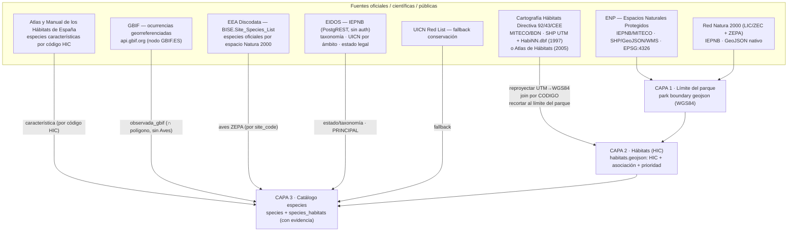

# Catálogo nacional NaturDex — el pipeline de datos, herramienta a herramienta

> **Para qué sirve este documento.** Es el detalle de **cómo funciona cada herramienta** del pipeline
> de tres capas: qué lee, qué escribe, qué opciones tiene y con qué trampas.
>
> **No empieces por aquí.** El **README raíz** es el manual operativo: modelo de datos (§3),
> procedencia de cada campo (§4), runbook completo (§5), trampas conocidas (§6) y orden de
> operaciones (§7). Este documento es la letra pequeña de las herramientas que ese runbook invoca.
> El histórico de sesiones está en `Docs/rollout/ESTADO.md`.

Estado (2026-08-04): **3 espacios en N2** (Cabo Cope y Puntas de Calnegre, Sierra Espuña, Cuatro
Calas) y **13 en N1**, toda la Región de Murcia. El pipeline está rodado sobre el huso 30N; el
primer cambio de huso llega con Cataluña/Aragón/Baleares (31N).

---

## 1. Principio de diseño (leer antes que nada)

**Ninguna base de datos oficial dice «la especie X vive en el polígono de hábitat Y».** Ese
vínculo **siempre es derivado**. Lo sólido es construirlo cruzando dos señales y **guardando de
dónde sale cada una** (columna de evidencia). Todo lo demás (límites, hábitats, taxonomía, estado
de conservación) sí es dato oficial directo.

Arquitectura en **3 capas**, la misma para cada parque:



---

## 2. Fuentes exactas (URLs, formato, CRS, claves)

### Capa 1 — Límites de parque (nacional/natural/regional)

| Fuente | Qué es | Acceso | CRS | Notas |
|---|---|---|---|---|
| **ENP** (Espacios Naturales Protegidos) | Todas las figuras (Ley 42/2007 + autonómicas) | IEPNB catálogo `408ec0c0-7823-5c91-9f72-8c06e3df8b9e`; WMS `https://wms.mapama.gob.es/sig/Biodiversidad/ENP/wms.aspx` | EPSG:4326 nativo | Capa nacional de referencia para el límite |
| **Red Natura 2000** (LIC/ZEC + ZEPA) | Espacios Natura 2000 | IEPNB catálogo `dc7a3014-cd9a-51b8-ad62-7aab55afecdd` | GeoJSON nativo | Da los **códigos de sitio** (ES…) → llave para la lista oficial de especies |

En el piloto el límite vino de `Frontend/Data/parks/<...>/geo/parque-regional.geojson` (IMIDA/CARM);
los códigos Natura 2000 están en `lic.geojson` (ES6200031, ES6200012) y `zepa.geojson` (ES0000261).

### Capa 2 — Polígonos de hábitats (HIC)

**Cartografía de Hábitats Directiva 92/43/CEE (MITECO/BDN)** — página de descargas por región:
`https://www.miteco.gob.es/es/biodiversidad/servicios/banco-datos-naturaleza/informacion-disponible/habitat_descargas_2.html`

Cada **región = código de provincia `NN`** (Murcia = 30). Dos ficheros por región:

| Fichero | Contenido | Campos clave |
|---|---|---|
| `DirectivaHabitatNN_1997_*.zip` | **Shapefile de polígonos** (recintos) | `.dbf`: `CODIGO` (id de recinto), municipio. **Sin HIC.** |
| `directivadatos_NN_*.zip` → `HabiNN.dbf` | **Tabla de atributos** por recinto | `CODIGO` (↔ shapefile), `CODIGO_UE` (**código HIC**), `CONCEPTO` (**asociación fitosociológica**), `PRIORITARI` (`*`), `COBERTURA` |

- **Join**: `shapefile.CODIGO` ↔ `HabiNN.CODIGO` (un recinto puede tener **varias filas = mosaico de HIC**).
- **CRS**: ETRS89 UTM — **el huso depende de la región** (Murcia = 30N / EPSG:25830; otras pueden ser 29N/31N; Canarias 28N/EPSG:32628). Reproyectar a WGS84 (ETRS89 ≈ WGS84, sin datum-shift).
- ⚠️ **`COBERTURA` viene vacía (0)** en el dato de 1997. ⚠️ El flag `PRIORITARI` es **poco fiable** (marca 8210 como prioritario); usar la **lista autorizada del Anexo I** para la prioridad.
- ⚠️ **Codificación antigua**: algunos HIC del 1997 hay que reconciliarlos (p. ej. `8230`+`Hypericion ericoidis` = roquedo casmofítico calcícola → hoy `8210`, no silíceo).
- ⚠️ **La cartografía de 1997 es la VIGENTE.** El MITECO declara que, hasta que exista la del
  Inventario Español de Hábitats Terrestres, lo publicado es la de 1997. La «CNH21 (2021)» que
  versiones anteriores de este documento daban como sucesora nacional **no lo es** (corregido el
  2026-07-25). Existe además el **Atlas de Hábitats de 2005** (`INB_Habitat<NN>` + `Datos<NN>.dbf`),
  con el que se construyó Cuatro Calas entero: `build-habitats.js` distingue las dos fuentes solo y
  etiqueta cada recinto con la suya (`atlas2005` / `hic1997`).

### Capa 3 — Catálogo de especies (la «BD»)

| Fuente | Rol | Acceso | Claves / notas |
|---|---|---|---|
| **EIDOS** (IEPNB) | **Principal**: taxonomía, nombres, **UICN por ámbito**, estado legal | PostgREST `https://iepnb.gob.es/api/especie/` (sin auth) | `v_taxonomia` (resuelve `taxonid` por `name=like.Genus species*`); en las vistas de detalle la clave es **`idtaxon`**. `v_estadoconservacion` (`aplicaa`=Mundial/España/Península/Canarias, `anio`, `vigencia`), `v_estadolegal` (`ambito`,`ccaa`), `v_atributos_pliniancore` (`Hábitat`, `Fitosociología`) |
| **UICN Red List** | **Fallback** de conservación cuando EIDOS no cubre | API UICN | ~54/124 especies del piloto sin dato UICN en EIDOS (sobre todo flora) |
| **GBIF** | **Empírico**: especies observadas ∩ polígono de hábitat | `https://api.gbif.org/v1/occurrence/search` | Descargar por bbox del parque, paginar, **point-in-polygon local** contra las geometrías. **Filtrar Aves** (88% de las ocurrencias = ruido espacial). El filtro por incertidumbre NO sirve (solo 14% la declaran). |
| **EEA Discodata (BISE)** | **Oficial por espacio**: especies del LIC/ZEC/ZEPA | `https://discodata.eea.europa.eu/sql?query=...` (URL-encode; bloquea tablas de sistema) | Tabla `[BISE].[latest].[Site_Species_List]` — columnas `site_code, species_group_name, id_eunis, scientific_name, common_name`. Filtrar por `site_code` del parque |
| **Atlas y Manual de los Hábitats de España** | **Característica por HIC** (backbone determinista) | Documental (MITECO), PDF en `Docs/Atlas y Manual de los Habitat de Espana.pdf` | Da la lista de especies típicas por código HIC; es el filtro de cordura sobre GBIF. Extraído con `pdftotext` y cruzado por `atlas-hic-especies.js` (ver §5) |

**Las aves NO se asignan a hábitats** (vuelan): van a un **apartado propio a nivel de parque
(migratorias/ZEPA)**, contrastado con la lista oficial de la ZEPA (Discodata BISE). En el piloto,
GBIF recuperó ~31/34 de las aves oficiales de la ZEPA ES0000261.

> **Reconciliación taxonómica (transversal y obligatoria).** Las tres fuentes usan nomenclaturas
> distintas y reclasifican (Larus→Ichthyaetus/Chroicocephalus, Salvia rosmarinus→Rosmarinus,
> Accipiter→Astur…). Hace falta una **clave maestra** por especie: usar el `taxonid` de EIDOS
> (o el `speciesKey` de GBIF) para no duplicar ni descuadrar conteos entre parques.

---

## 3. Modelo de datos (ajustes para escala nacional)

- `species` con **`eidos_taxonid`** como clave estable → una especie compartida por N parques no se duplica.
- `habitats` con **`hic_code`/`lpeh_code`** → el crosswalk «especies características por HIC» se reutiliza por código en toda España.
- `species_habitats` (N:M) con columna **`evidence`** (`caracteristica` | `observada_gbif` | `zepa`) + métrica (nº ocurrencias) → da «el número real» **y** su justificación.

Propiedades por hábitat en el geojson (ya implementadas en el piloto): `code`(HIC), `hic_subtipos`,
`name`, `type`, `priority` (Anexo I), `hectares`, `fitosociologia` (asociaciones oficiales), `source`.

---

## 4. Procedimiento por parque (repetible)

> El runbook con los comandos exactos, la checklist de cierre y la definición de «terminado» está en
> el **README raíz §5**. Aquí queda el esqueleto conceptual, que es lo que no cambia.

**Parámetros que cambian por parque** → `<PARK_SLUG>`, `<REGION_NN>` (código provincia), `<UTM_ZONE>`
(huso, **leído del `.prj`**), `<SITE_CODES>` (ES… del LIC/ZEPA), ruta al límite en WGS84.

1. **Límite** — obtener el geojson del límite (ENP nacional o la fuente regional) en WGS84.
2. **Hábitats**
   1. Descargar de MITECO `DirectivaHabitat<NN>_*.zip` (shapefile) y `directivadatos_<NN>_*.zip` (`Habi<NN>.dbf`), o los del Atlas de 2005 (`INB_Habitat<NN>` + `Datos<NN>.dbf`).
   2. Parsear `.shp`, **reproyectar UTM `<UTM_ZONE>`N → WGS84**.
   3. **Join** shapefile.`CODIGO` ↔ `Habi<NN>`.`CODIGO` → HIC + asociación + prioridad por recinto.
   4. **Recortar** cada recinto al límite del parque (intersección de polígonos robusta).
   5. Descartar recintos sin HIC (marco/artefactos). **Prioridad** desde la lista Anexo I, no del flag 1997. Reconciliar códigos antiguos (p. ej. 8230→8210 según asociación).
   6. (Opcional) **Merge** con una capa curada previa: enriquecer atributos, añadir hábitats oficiales que falten, mantener los curados.
3. **Especies**
   1. **EIDOS** (principal) + **UICN** (fallback) → taxonomía + estado por especie.
   2. **Atlas de Hábitats** → especies características por HIC (`atlas-hic-especies.js`) → backbone determinista y filtro de cordura.
   3. **GBIF** ∩ polígonos de hábitat, **sin Aves** → `observada_gbif`.
   4. **Aves** → apartado migratorias/ZEPA, contrastado con **Discodata BISE** por `<SITE_CODES>`.
4. **Reconciliación taxonómica** con `eidos_taxonid`/`speciesKey` como clave maestra.
5. **Adoptar** la capa fusionada como la del espacio (`adopt-habitats.js`).
6. **Validar** (`npm run validate`) y cuadrar contadores hábitat/especie.

---

## 5. Las herramientas

Todas viven bajo `Tools/`. La **infraestructura compartida** está en `Tools/lib/` (antes en
`Tools/catalogo-nacional/lib/`; se movió porque los scripts de `Tools/` necesitaban lo mismo y lo
reimplementaban): ver la tabla del README raíz §2. Ninguna herramienta de Capa 2/3 escribe en la BD
ni en el seed directamente —salvo `enrich-images.js --write-park`, documentado en su cabecera—:
generan ficheros en `out/` para revisar antes de adoptarlos.

### Capa 1 · límite y ficha base

| Script | npm | Qué hace |
|---|---|---|
| `build-n1-espacios.js` | `n1:build` | Genera las fichas N1 de una comunidad entera desde las capas nacionales del MITECO. **Idempotente.** Respeta la marca `CodigoIMIDA`: no pisa un límite ya refinado (para rehacer uno, borra su carpeta) |
| `refina-limites-imida.js` | `n1:refina` | Sustituye el límite generalizado del ENP nacional por la delimitación del geoportal autonómico (2–15× más vértices). Solo geometrías `Caracter = 'Firme'`. Cachea las capas en `fuentes/imida-enp/` |
| `Tools/build-park-trails.js` | `trails:build` | Senderos señalizados (GR/PR/SL) de OpenStreetMap recortados al polígono oficial (no al bbox) |
| `Tools/build-park-tiles.js` | `tiles:build` | Paquete de mapa base offline (`.pmtiles`) recortado al límite oficial |

### Capa 2 · hábitats

| Script | npm | Qué hace |
|---|---|---|
| `build-habitats.js` | `habitats:build` | Reproyecta UTM→WGS84, une por `CODIGO` y **recorta al límite**. → `out/<slug>-oficial.geojson`. `--zone` fuerza el huso; por defecto lo lee del `.prj` |
| `merge-habitats.js` | `habitats:merge` | Fusiona la capa oficial con la curada: enriquece, conserva lo curado y añade los HIC oficiales que falten. → `out/<slug>-merged.geojson`. La procedencia la lee de la capa oficial, no la escribe a mano |
| `adopt-habitats.js` | `habitats:adopt` | Lleva el merged a `Frontend/`, sincroniza `park.json` y recalcula el manifiesto. `--dry` para revisar. Aplica la **regla marina** y las excepciones de `data/hic-excluidos.json` |
| `Tools/sync-habitat-catalog.js` | `habitats:check` `habitats:apply` | El equivalente del catálogo universal para hábitats: **una descripción por código HIC**, la misma en todos los espacios. Exporta además `Frontend/Data/fitosociologia.json`, la lectura en llano de las asociaciones (la cita oficial no se toca) |

### Capa 3 · especies

| Script | npm | Qué hace |
|---|---|---|
| `atlas-hic-especies.js` | `atlas:hic` | Atlas (PDF → `pdftotext -layout`) → especies características por HIC = evidencia `caracteristica` |
| `Tools/gbif-habitats.js` | `gbif:habitats` | GBIF ∩ polígonos de hábitat + análisis de ruido. Cachea las ocurrencias en disco (`--refresh` fuerza la descarga) |
| `reconcile-taxa.js` | `taxones:reconcilia` | Tabla maestra `eidos_taxonid` ↔ `gbif_speciesKey`, resolviendo sinonimias. Avisa de las claves de GBIF de rango superior a especie |
| `Tools/eidos-diff.js` | `eidos:diff` | Coteja la BD viva contra EIDOS (solo lectura). `--ccaa` elige el catálogo autonómico |
| `fix-estado-conservacion-iepnb.js` | — | Aplica al piloto las correcciones derivadas de la Lista Patrón del IEPNB. Idempotente, `--dry` |
| `Tools/sync-species-catalog.js` | `species:check` `species:extract` `species:apply` | El catálogo universal: una especie, una ficha, en todos los espacios |
| `Tools/scan-taxones-duplicados.js` | `taxones:duplicados` | El mismo taxón con dos nombres científicos. Agrupa por identificador externo, no por nombre |

### Fotos e invasoras

| Script | npm | Qué hace |
|---|---|---|
| `wikimedia-images.js` | `images:species` | Foto de cada especie contra Wikidata/Wikipedia/Commons, con URL canónica `Special:FilePath` y atribución |
| `habitat-images.js` | `images:habitats` | Portada de hábitat: su especie diagnóstica, explicada en `imageNote` |
| `enrich-images.js` | — | Fotos desde EIDOS con respaldo en GBIF. Ordena *foto de campo antes que pliego* → licencia → país |
| `invasoras-eei.js` | `invasoras:eei` | Catálogo EEI (RD 630/2013) ∩ presencia GBIF por territorio |
| `invasoras-contenido.js` | `contenido:invasoras` | Fichas de invasoras desde EIDOS, limpiando los restos del formulario de origen |
| `invasoras-images.js` | `images:invasoras` | Sus fotos, misma cadena de resolución que el catálogo |

### Verificación

| Script | npm | Qué hace |
|---|---|---|
| `Tools/validate-park-data.js` | `validate` | La red de seguridad. **Bloquea el commit.** Coherencia `park.json ↔ manifest ↔ geojson`, integridad especie↔hábitat, contadores, coordenadas, licencias, transcripciones y presupuesto offline |
| `Tools/glossary-coverage.js` | `glossary:check` | Vocabulario científico de las fichas sin definición en el glosario |

### Datos de referencia (`data/`)

| Fichero | Qué es |
|---|---|
| `hic-prioritarios.json` | Códigos HIC prioritarios del Anexo I. **Fuente de verdad de `priority`** — nunca el flag `PRIORITARI` de 1997 |
| `hic-nombres.json` | Nombre y tipo por código HIC. ⚠️ Un código ausente **se salta el filtro marino** (README raíz §6) |
| `hic-excluidos.json` | Excepciones por espacio: códigos que la cartografía recorta dentro pero que el formulario normalizado no declara |
| `especies-universal.json` | El catálogo universal: los campos que describen a la especie, indexados por nombre científico |
| `contenido/*.json` | Texto redactado a mano. **Manda sobre lo extraído** — cuidado con las entradas obsoletas (README raíz §7.2). Los ficheros por tanda van indexados por nombre científico; `habitats.json` y `fitosociologia.json` son la excepción (ver la fila siguiente) |
| `contenido/habitats.json` | Descripción divulgativa por **código HIC**, universal para todos los parques de España. La aplica `sync-habitat-catalog.js` |
| `contenido/fitosociologia.json` | Lectura en llano de cada asociación fitosociológica (nombre entendible, plantas que la nombran, rango) + cómo se lee la nomenclatura. Indexado por el **nombre latino sin autoría**. No sustituye a la cita oficial: la acompaña |
| `descripciones-espacios.json` | La descripción de cada espacio. **El único texto del pipeline redactado a mano**; `build-n1-espacios.js` la lee de aquí para que una regeneración no la pise |
| `murcia-enp-municipios.json`, `senderos-fmrm-murcia.json` | Datos de apoyo de la comunidad piloto |

### Uso (ejemplo real, piloto verificado)

```bash
# 1) Capa oficial recortada al parque (--zone = huso UTM leído del .prj)
node Tools/catalogo-nacional/build-habitats.js \
  --park cabo-cope-puntas-calnegre \
  --shp   <ruta>/DirectivaHabitat30_1997.shp \
  --datos <ruta>/Habi30.dbf \
  --zone  30

# 2) Fusión con la capa curada (--reconcile solo si la asociación lo justifica)
node Tools/catalogo-nacional/merge-habitats.js \
  --park cabo-cope-puntas-calnegre \
  --official Tools/catalogo-nacional/out/cabo-cope-puntas-calnegre-oficial.geojson \
  --reconcile 8230:8210

# 3) Adopción como capa real del espacio
node Tools/catalogo-nacional/adopt-habitats.js --park cabo-cope-puntas-calnegre --dry
node Tools/catalogo-nacional/adopt-habitats.js --park cabo-cope-puntas-calnegre
```

**Resultado del piloto**: 28 recintos oficiales recortados (0 vértices fuera del parque) → 16
hábitats fusionados = 10 enriquecidos + 5 solo-curada + 1 añadido; 11/16 con fitosociología oficial.
Tras la revisión del 2026-08-01 (retirados el 1110 marino y el 9560 duplicado) el espacio sirve 15.

### Sobre `out/`

El diseño original marcaba esta carpeta como no versionada. En algún punto `main` empezó a versionar
las salidas del piloto de todos modos, y así sigue: son útiles como referencia de formato y como
prueba de reproducibilidad. Ojo con una consecuencia: `out/<slug>-merged.geojson` puede quedar
desfasado respecto a `Frontend/.../habitats.geojson` si la capa curada avanzó después (le pasa al
piloto, cuya capa curada se rehizo con el Atlas de 2005). **La fuente de verdad es la de `Frontend/`.**

### Dependencia

**`polygon-clipping` es la única dependencia del repo.** La usa el recorte de hábitats. Se optó por
ella tras comprobar que un Greiner-Hormann propio, aun pasando los tests unitarios (incluido recorte
cóncavo), **falla con los tramos de costa colineales** entre el límite del parque y los polígonos
marinos. El resto del tooling sigue siendo zero-dep y el `Frontend` no depende de nada.

---

## 6. Ficheros de origen (fuera del repo)

Los ZIP del MITECO **no se versionan** (pesan y son reproducibles: sus URL literales, por provincia,
están en `fuentes/habitat-provincias.json`). Lo que sí está versionado y no hay que volver a
descargar:

- `fuentes/FUENTES.json` — fichas de ENP, Red Natura 2000, Hábitat art. 17 y riqueza de especies.
- `fuentes/habitat-provincias.json` — **las 50 provincias** con la URL literal de su shapefile y de
  su tabla de atributos. Los sufijos `_tcm30-NNNNNN` **no son derivables**: están copiados a mano de
  las páginas de descarga del MITECO. Es el fichero que ahorra media hora por provincia nueva.
- `fuentes/iepnb-api.json` — la API PostgREST del IEPNB, sin autenticación.
- `fuentes/imida-enp/capa-*.json` — las cinco capas del geoportal murciano, ya descargadas.

En la máquina de desarrollo original los ZIP y el shapefile extraído de Murcia estaban bajo
`Desktop\Murcia\` y `Desktop\NaturDex-work\fuentes-mitec\`. Son rutas de una sola máquina: si no
están, se vuelven a descargar desde `habitat-provincias.json`.

---

## 7. Deuda propia del pipeline

La lista priorizada y completa está en el **README raíz §9**. Lo que toca específicamente a estas
herramientas:

1. **El pipeline de hábitats no escribe en la BD.** `adopt-habitats.js` toca `Frontend/` y nada más,
   así que un export desde la API borraría sus cambios sin avisar.
2. **Tabla de reconciliación taxonómica nacional.** Existe la del piloto
   (`out/cabo-cope-puntas-calnegre-reconciliacion.json`, 124 especies, generada por
   `reconcile-taxa.js`); falta acumular todos los espacios sin duplicar por `eidos_taxonid`.
3. **Completar `data/hic-prioritarios.json` y `data/hic-nombres.json`** al entrar en cada provincia
   nueva. No es opcional: un código sin ficha se salta el filtro marino.
4. **Primer cambio de huso UTM** (31N con Cataluña/Aragón/Baleares) y, más adelante, **28N en
   Canarias**, donde además EIDOS trata los endemismos en su propio ámbito (`aplicaa` = "Canarias") y
   los hábitats macaronésicos no están en el Atlas peninsular.
5. **Catálogos regionales de especies amenazadas**: hace falta una tabla comunidad → norma. Ver la
   deuda nº 1 del README raíz (`murcia_status` está atado a Murcia).

---

## Prompt para retomar

> Retomo el rollout de NaturDex. Contexto: el **README raíz** (modelo, procedencia de cada campo,
> runbook, trampas y orden de operaciones) y este documento para el detalle de cada herramienta. El
> estado por espacio está en `Docs/rollout/ESTADO.md`.
>
> El pipeline está rodado sobre tres espacios de Murcia (huso 30N) y las herramientas de las tres
> capas están completas y verificadas. Para un espacio nuevo que ya esté en N1 basta descargar sus
> dos ficheros del MITECO y seguir el runbook del README §5.
>
> Empieza por preguntarme **qué espacio** procesamos y confírmame su `REGION_NN`, el **huso UTM leído
> del `.prj`** (no lo asumas) y sus códigos Natura 2000 antes de descargar nada. Si alguno no cuadra,
> para y dímelo.
