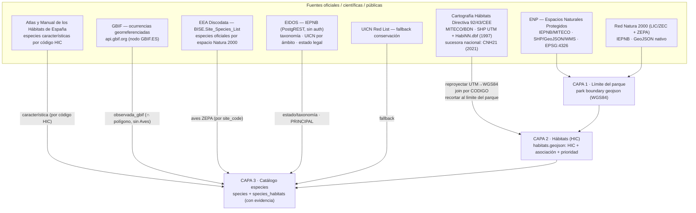

# Catálogo nacional NaturDex — fuentes de datos y procedimiento por parque

> **Para qué sirve este documento.** Es el mapa de **de dónde sale cada dato** (límites de
> parques, polígonos de hábitats, catálogo de especies) y el **procedimiento repetible** para
> construir los datos de *cualquier* parque de España con fuentes **oficiales, científicas y
> públicas**. Está pensado también como **prompt de arranque para futuras sesiones**: si retomas
> esto, lee la sección [«Prompt para retomar»](#prompt-para-retomar) al final.

Estado: **piloto completado** — *Cabo Cope y Puntas de Calnegre* (Murcia). El resto de parques
está pendiente de ejecutar con este mismo procedimiento.

> **Nota (2026-07-25).** `build-habitats.js`, `merge-habitats.js`, `lib/` y `data/` se escribieron
> en la rama `catalogo-nacional` y nunca se fusionaron a `main`: `main` tenía las SALIDAS del
> piloto versionadas (`out/*.geojson`) pero no el código que las genera, y `package.json` apuntaba
> a scripts inexistentes (`npm run habitats:build`/`habitats:merge`). Se han recuperado desde esa
> rama (commit `02b7459`) y verificado que reproducen byte a byte `out/cabo-cope-puntas-calnegre-
> {oficial,merged}.geojson` a partir del shapefile original del MITECO. Ver §5 para el estado real
> de cada herramienta a día de hoy — varias cosas descritas en este documento han evolucionado en
> `main` sin que el documento se actualizara; se corrige aquí.

---

## 1. Principio de diseño (leer antes que nada)

**Ninguna base de datos oficial dice «la especie X vive en el polígono de hábitat Y».** Ese
vínculo **siempre es derivado**. Lo sólido es construirlo cruzando dos señales y **guardando de
dónde sale cada una** (columna de evidencia). Todo lo demás (límites, hábitats, taxonomía, estado
de conservación) sí es dato oficial directo.

Arquitectura en **3 capas**, la misma para cada parque:



---

## 2. Fuentes exactas (URLs, formato, CRS, claves)

### Capa 1 — Límites de parque (nacional/natural/regional)

| Fuente | Qué es | Acceso | CRS | Notas |
|---|---|---|---|---|
| **ENP** (Espacios Naturales Protegidos) | Todas las figuras (Ley 42/2007 + autonómicas) | IEPNB catálogo `408ec0c0-7823-5c91-9f72-8c06e3df8b9e`; WMS `https://wms.mapama.gob.es/sig/Biodiversidad/ENP/wms.aspx` | EPSG:4326 nativo | Capa nacional de referencia para el límite |
| **Red Natura 2000** (LIC/ZEC + ZEPA) | Espacios Natura 2000 | IEPNB catálogo `dc7a3014-cd9a-51b8-ad62-7aab55afecdd` | GeoJSON nativo | Da los **códigos de sitio** (ES…) → llave para la lista oficial de especies |

En el piloto el límite vino de `Frontend/Data/parks/<...>/geo/parque-regional.geojson` (IMIDA/CARM);
los códigos Natura 2000 están en `lic.geojson` (ES6200031, ES6200012) y `zepa.geojson` (ES0000261).

### Capa 2 — Polígonos de hábitats (HIC)

**Cartografía de Hábitats Directiva 92/43/CEE (MITECO/BDN)** — página de descargas por región:
`https://www.miteco.gob.es/es/biodiversidad/servicios/banco-datos-naturaleza/informacion-disponible/habitat_descargas_2.html`

Cada **región = código de provincia `NN`** (Murcia = 30). Dos ficheros por región:

| Fichero | Contenido | Campos clave |
|---|---|---|
| `DirectivaHabitatNN_1997_*.zip` | **Shapefile de polígonos** (recintos) | `.dbf`: `CODIGO` (id de recinto), municipio. **Sin HIC.** |
| `directivadatos_NN_*.zip` → `HabiNN.dbf` | **Tabla de atributos** por recinto | `CODIGO` (↔ shapefile), `CODIGO_UE` (**código HIC**), `CONCEPTO` (**asociación fitosociológica**), `PRIORITARI` (`*`), `COBERTURA` |

- **Join**: `shapefile.CODIGO` ↔ `HabiNN.CODIGO` (un recinto puede tener **varias filas = mosaico de HIC**).
- **CRS**: ETRS89 UTM — **el huso depende de la región** (Murcia = 30N / EPSG:25830; otras pueden ser 29N/31N; Canarias 28N/EPSG:32628). Reproyectar a WGS84 (ETRS89 ≈ WGS84, sin datum-shift).
- ⚠️ **`COBERTURA` viene vacía (0)** en el dato de 1997. ⚠️ El flag `PRIORITARI` es **poco fiable** (marca 8210 como prioritario); usar la **lista autorizada del Anexo I** para la prioridad.
- ⚠️ **Codificación antigua**: algunos HIC del 1997 hay que reconciliarlos (p. ej. `8230`+`Hypericion ericoidis` = roquedo casmofítico calcícola → hoy `8210`, no silíceo).
- **Sucesora moderna (recomendada para el rollout nacional)**: **CNH21 (2021)**, doble leyenda LPEH+HIC, catálogo IEPNB `2a7fc624-0d69-4788-9bdd-49ee01fb1fe9`. No está en la página de 1997.

### Capa 3 — Catálogo de especies (la «BD»)

| Fuente | Rol | Acceso | Claves / notas |
|---|---|---|---|
| **EIDOS** (IEPNB) | **Principal**: taxonomía, nombres, **UICN por ámbito**, estado legal | PostgREST `https://iepnb.gob.es/api/especie/` (sin auth) | `v_taxonomia` (resuelve `taxonid` por `name=like.Genus species*`); en las vistas de detalle la clave es **`idtaxon`**. `v_estadoconservacion` (`aplicaa`=Mundial/España/Península/Canarias, `anio`, `vigencia`), `v_estadolegal` (`ambito`,`ccaa`), `v_atributos_pliniancore` (`Hábitat`, `Fitosociología`) |
| **UICN Red List** | **Fallback** de conservación cuando EIDOS no cubre | API UICN | ~54/124 especies del piloto sin dato UICN en EIDOS (sobre todo flora) |
| **GBIF** | **Empírico**: especies observadas ∩ polígono de hábitat | `https://api.gbif.org/v1/occurrence/search` | Descargar por bbox del parque, paginar, **point-in-polygon local** contra las geometrías. **Filtrar Aves** (88% de las ocurrencias = ruido espacial). El filtro por incertidumbre NO sirve (solo 14% la declaran). |
| **EEA Discodata (BISE)** | **Oficial por espacio**: especies del LIC/ZEC/ZEPA | `https://discodata.eea.europa.eu/sql?query=...` (URL-encode; bloquea tablas de sistema) | Tabla `[BISE].[latest].[Site_Species_List]` — columnas `site_code, species_group_name, id_eunis, scientific_name, common_name`. Filtrar por `site_code` del parque |
| **Atlas y Manual de los Hábitats de España** | **Característica por HIC** (backbone determinista) | Documental (MITECO), PDF en `Docs/Atlas y Manual de los Habitat de Espana.pdf` | Da la lista de especies típicas por código HIC; es el filtro de cordura sobre GBIF. Extraído con `pdftotext` y cruzado por `atlas-hic-especies.js` (ver §5) |

**Las aves NO se asignan a hábitats** (vuelan): van a un **apartado propio a nivel de parque
(migratorias/ZEPA)**, contrastado con la lista oficial de la ZEPA (Discodata BISE). En el piloto,
GBIF recuperó ~31/34 de las aves oficiales de la ZEPA ES0000261.

> **Reconciliación taxonómica (transversal y obligatoria).** Las tres fuentes usan nomenclaturas
> distintas y reclasifican (Larus→Ichthyaetus/Chroicocephalus, Salvia rosmarinus→Rosmarinus,
> Accipiter→Astur…). Hace falta una **clave maestra** por especie: usar el `taxonid` de EIDOS
> (o el `speciesKey` de GBIF) para no duplicar ni descuadrar conteos entre parques.

---

## 3. Modelo de datos (ajustes para escala nacional)

- `species` con **`eidos_taxonid`** como clave estable → una especie compartida por N parques no se duplica.
- `habitats` con **`hic_code`/`lpeh_code`** → el crosswalk «especies características por HIC» se reutiliza por código en toda España.
- `species_habitats` (N:M) con columna **`evidence`** (`caracteristica` | `observada_gbif` | `zepa`) + métrica (nº ocurrencias) → da «el número real» **y** su justificación.

Propiedades por hábitat en el geojson (ya implementadas en el piloto): `code`(HIC), `hic_subtipos`,
`name`, `type`, `priority` (Anexo I), `hectares`, `fitosociologia` (asociaciones oficiales), `source`.

---

## 4. Procedimiento por parque (repetible)

**Parámetros que cambian por parque** → `<PARK_SLUG>`, `<REGION_NN>` (código provincia), `<UTM_ZONE>`
(huso), `<SITE_CODES>` (ES… del LIC/ZEPA), ruta al `park boundary geojson` (WGS84).

1. **Límite** — obtener el geojson del límite (ENP nacional o la fuente regional) en WGS84.
2. **Hábitats**
   1. Descargar de MITECO `DirectivaHabitat<NN>_*.zip` (shapefile) y `directivadatos_<NN>_*.zip` (`Habi<NN>.dbf`). *(Alternativa moderna: tesela CNH21 2021.)*
   2. Parsear `.shp`, **reproyectar UTM `<UTM_ZONE>`N → WGS84**.
   3. **Join** shapefile.`CODIGO` ↔ `Habi<NN>`.`CODIGO` → HIC + asociación + prioridad por recinto.
   4. **Recortar** cada recinto al límite del parque (intersección de polígonos robusta).
   5. Descartar recintos sin HIC (marco/artefactos). **Prioridad** desde la lista Anexo I, no del flag 1997. Reconciliar códigos antiguos (p. ej. 8230→8210 según asociación).
   6. (Opcional) **Merge** con una capa curada previa: enriquecer atributos, añadir hábitats oficiales que falten, mantener los curados.
3. **Especies**
   1. **EIDOS** (principal) + **UICN** (fallback) → taxonomía + estado por especie.
   2. **Atlas de Hábitats** → especies características por HIC (`atlas-hic-especies.js`) → backbone determinista y filtro de cordura.
   3. **GBIF** ∩ polígonos de hábitat, **sin Aves** → `observada_gbif`.
   4. **Aves** → apartado migratorias/ZEPA, contrastado con **Discodata BISE** por `<SITE_CODES>`.
4. **Reconciliación taxonómica** con `eidos_taxonid`/`speciesKey` como clave maestra.
5. **Validar** (`node Tools/validate-park-data.js`) y cuadrar contadores hábitat/especie.

---

## 5. Herramientas — estado real (2026-07-25)

```
Tools/catalogo-nacional/
├── README.md                          ← este documento
├── build-habitats.js                  ← CAPA 2: shapefile MITECO → capa oficial recortada al parque
├── merge-habitats.js                  ← CAPA 2: fusiona la capa oficial con la curada del parque
├── atlas-hic-especies.js              ← CAPA 3: Atlas de Hábitats (PDF) → especies características por HIC
├── enrich-images.js                   ← CAPA 3: fotos con licencia (EIDOS, fallback GBIF)
├── invasoras-eei.js                   ← CAPA 3: catálogo EEI (RD 630/2013) ∩ presencia GBIF por territorio
├── lib/
│   ├── shapefile.js                   ← parser .shp (polígonos) + reproyección inversa UTM (cualquier huso)
│   ├── dbf.js                         ← lector dBASE (.dbf)
│   ├── geo.js                         ← bbox, punto-en-polígono, áreas, orientación de anillos
│   └── registry.js                    ← localiza los geo del parque en parks-index.json
├── data/
│   ├── hic-prioritarios.json          ← códigos HIC prioritarios (Anexo I) — fuente de verdad
│   └── hic-nombres.json               ← nombre/tipo por código HIC (para los hábitats añadidos)
└── out/                               ← salidas generadas
```

| Script | Qué hace | Escribe | Estado |
|---|---|---|---|
| `build-habitats.js` | Reproyecta UTM→WGS84, une por `CODIGO`, recorta al límite del parque | `out/<slug>-oficial.geojson` | **Recuperado** de la rama `catalogo-nacional` (nunca se había fusionado a `main`); verificado byte a byte contra la salida del piloto |
| `merge-habitats.js` | Enriquece la capa curada, mantiene lo suyo, añade HIC oficiales que falten | `out/<slug>-merged.geojson` | **Recuperado**, ídem |
| `atlas-hic-especies.js` | CAPA 3: cruza el Atlas (PDF, extraído con `pdftotext`) con el catálogo del parque | JSON de enlaces `caracteristica` | Presente en `main`. Sustituye a un primer script (`hic-especies-caracteristicas.js`, por género de sintaxón) que existía en la rama pero quedó obsoleto en cuanto se dispuso del texto del Atlas — no se ha recuperado por no aportar ya nada |
| `enrich-images.js` | Fotos con licencia por especie (EIDOS, fallback GBIF) | `.sql` de UPDATEs + informe | Presente en `main`. No existía en el diseño original de esta carpeta |
| `invasoras-eei.js` | EEI oficiales (EIDOS) ∩ presencia GBIF por CCAA/provincia | JSON rankeado | Presente en `main`. Tampoco existía en el diseño original |
| `Tools/eidos-diff.js` | CAPA 3: cotejo BD ↔ EIDOS (conservación/estado) | informe `.md` | **Referenciado por `npm run eidos:diff` pero el fichero NO existe en `main`.** Existe en la rama `catalogo-nacional` y en la copia de disco (ver más abajo); no se ha recuperado en esta pasada por no estar en el alcance pedido — mismo síntoma que build/merge-habitats |
| `Tools/gbif-habitats.js` | CAPA 3: GBIF ∩ polígonos + análisis de ruido | informe `.md`/`.json` | **Mismo caso**: referenciado por `npm run gbif:habitats`, ausente en `main`, presente en la rama y en la copia de disco |
| `reconcile-taxa.js` | Tabla maestra `eidos_taxonid` ↔ `gbifSpeciesKey` del parque | `out/<slug>-reconciliacion.json` | **Ausente en `main` y sin script npm.** Su salida para el piloto SÍ está versionada (`out/cabo-cope-puntas-calnegre-reconciliacion.json`); el script en sí solo existe en la rama y en la copia de disco |

Ninguna de las herramientas de Capa 2/3 escribe en la BD, el seed ni el `habitats.geojson` curado
directamente (salvo `enrich-images.js --write-park`, documentado en su cabecera): generan ficheros
en `out/` para revisar antes de adoptarlos.

**Sobre `out/`**: el diseño original marcaba esta carpeta como no versionada (`out/.gitignore` con
`*`). En algún punto posterior `main` empezó a versionar las 5 salidas del piloto de todos modos
(`cabo-cope-puntas-calnegre-{oficial,merged,hic-especies,reconciliacion}` + `preview.html`). Esta
recuperación no revierte esa decisión — solo la deja documentada — porque no está en el alcance
pedido (reparar herramientas, no cambiar políticas de versionado).

### Uso (ejemplo real, piloto verificado)

```bash
# Windows: cmd.exe no tiene Node en el PATH
export PATH="/c/Program Files/nodejs:$PATH"

# 1) Capa oficial recortada al parque (--zone = huso UTM de la región)
node Tools/catalogo-nacional/build-habitats.js \
  --park cabo-cope-puntas-calnegre \
  --shp  <ruta>/DirectivaHabitat30_1997.shp \
  --habi <ruta>/Habi30.dbf \
  --zone 30

# 2) Fusión con la capa curada (--reconcile solo si la asociación lo justifica)
node Tools/catalogo-nacional/merge-habitats.js \
  --park cabo-cope-puntas-calnegre \
  --official Tools/catalogo-nacional/out/cabo-cope-puntas-calnegre-oficial.geojson \
  --reconcile 8230:8210
```

También como `npm run habitats:build -- --park … ` y `npm run habitats:merge -- --park …`.

**Resultado del piloto** (reproducido el 2026-07-25 contra el shapefile original — coincide byte a
byte con `out/cabo-cope-puntas-calnegre-{oficial,merged}.geojson`): 28 recintos oficiales recortados
(0 vértices fuera del parque) → 16 hábitats fusionados = 10 enriquecidos + 5 solo-curada + 1 añadido
(Posidonia 1120); prioritarios 1510, 5220, 6110, 6220, 1120; 11/16 con fitosociología oficial.

### Dependencia

**`polygon-clipping` es la única dependencia del repo** (declarada en `package.json`). La usa el
recorte de hábitats. Se optó por ella tras comprobar que un Greiner-Hormann propio, aun pasando
los tests unitarios (incluido recorte cóncavo), **falla con los tramos de costa colineales** entre
el límite del parque y los polígonos marinos. El resto del tooling sigue siendo zero-dep y el
`Frontend` no depende de nada.

---

## 6. Ficheros de apoyo del piloto (fuera del repo)

Los ZIP originales del MITECO y el shapefile extraído están en dos sitios en disco (ninguno
versionado):

- `C:\Users\Deathscythe\Desktop\Murcia\` — shapefile + `.dbf` ya extraídos (sin los `.zip`).
- `C:\Users\Deathscythe\Desktop\NaturDex-work\fuentes-mitec\` — los `.zip` originales
  (`directivahabitat30.zip`, `directivadatos_30.zip`) más el mismo shapefile y `Habi30.dbf` ya
  extraídos, y en `NaturDex-work\api-outputs\`/`resultados-catalogo\` las salidas intermedias del
  piloto (incluye ejecuciones de `eidos-diff.js` y `gbif-habitats.js`, que ya no están en `main`).
- `C:\Users\Deathscythe\Desktop\NaturDex - copia\` — una copia de trabajo completa del repo de esa
  fecha, con **todo** el código de `Tools/catalogo-nacional/` intacto (incluido lo que sigue sin
  recuperar en `main`: `Tools/eidos-diff.js`, `Tools/gbif-habitats.js`, `reconcile-taxa.js`,
  `hic-especies-caracteristicas.js`). Es la fuente más rápida si se decide recuperar el resto.

---

## Prompt para retomar

> Retomo el **catálogo nacional de NaturDex**. Contexto en `Tools/catalogo-nacional/README.md`:
> arquitectura de 3 capas (límite ENP/Natura2000 → hábitats HIC del MITECO → especies
> EIDOS+GBIF+ZEPA+Atlas). El **piloto** (Cabo Cope, Murcia) está hecho:
> `Frontend/Data/parks/murcia/cabo-cope-puntas-calnegre/geo/habitats.geojson`.
>
> La **Capa 2 está empaquetada y verificada**: `build-habitats.js` + `merge-habitats.js` (ver §5
> «Uso»). Para un parque nuevo basta descargar sus 2 ficheros del MITECO y lanzarlos.
>
> Tareas abiertas:
> 1. Decidir si se recuperan también `Tools/eidos-diff.js`, `Tools/gbif-habitats.js`,
>    `reconcile-taxa.js` y `hic-especies-caracteristicas.js` desde la rama `catalogo-nacional` /
>    la copia de disco en `Desktop\NaturDex - copia\` — están en la misma situación que
>    build/merge-habitats estaban antes de esta recuperación (código perdido, salida versionada).
> 2. Tabla de **reconciliación taxonómica** nacional (`eidos_taxonid` / `speciesKey` de GBIF) —
>    el piloto ya tiene una para sus 124 especies (`out/cabo-cope-puntas-calnegre-reconciliacion.json`,
>    generada por `reconcile-taxa.js`); falta decidir si es la base de la tabla maestra nacional o
>    hay que rehacerla con otro criterio (ver Docs/rollout/ESTADO.md §7.1).
> 3. Completar `data/hic-prioritarios.json` y `data/hic-nombres.json` al añadir regiones nuevas.
> 4. Valorar migrar la cartografía de hábitats **1997 → CNH21 (2021)** (más moderna, doble leyenda
>    LPEH+HIC); el pipeline actual asume el formato de 1997 (shapefile + `Habi<NN>.dbf`).
>
> Empieza por preguntarme **qué parque** procesamos y confirma su `REGION_NN`, **huso UTM** y
> códigos Natura 2000 antes de descargar nada.
